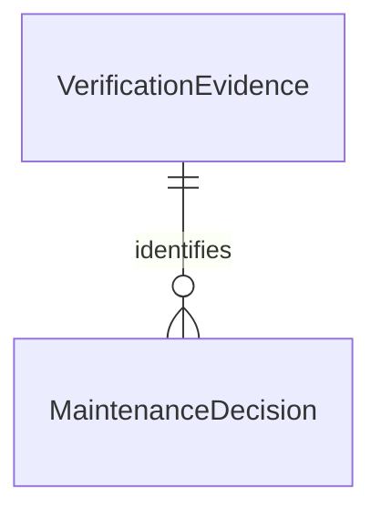

# Functional Specification — U2

## Scope and Ownership

ドキュメント根拠：承認済みFR6/FR7、全NFR、C2/C3、MaintenancePolicyの境界。動作は未検証。判定入力を受け取って不変の結果を返すlibraryであり、外部取得・credential・差分生成・lock導入・push・mergeはU3が担当する。判定呼出しでファイル・環境・ネットワークを読み取らない。

## Entities and Relationships (Derived)

テキスト代替：複数のMaintenanceDecisionは同一VerificationEvidenceを外部参照できる。所有entityと属性の正本はentities.md。図はER文法の1関係文として構文を確認した。描画は未検証。

## Common Workflow

1. C3 request、trusted baseのpolicy、C2独立観測を受け取る。policyは呼出し側が信頼境界を保証し、PR提出policyは拒否する。
2. schema版1、operation、必須型、正のPR/run/attempt、完全SHA、digest、配列の一意性・上限を検査する。不成立は理由付きrejectとして終了する。
3. 同一repository、open PR、trusted workflow、request headとcurrent headの一致を確認する。repositoryはtrusted policyの完全一致を用い、branch表示名で同一性を判定しない。
4. C2のrepository/source/run/attempt/workflow/artifact digest/toolchainと独立観測、check名/producer/SHA/runを照合する。同名偽producer、重複、missing、skip/pending/failure/cancelを拒否する。ordinary-ciをpublication-candidateへ読み替えない。
5. C3の共通requiredCheckProducersを両operationへ適用する。空集合も不成立。整形前lintが失敗する場合は拒否し手動へ渡す。この制約は受入れ済み契約指摘を引き継ぐもので、整形専用checksへ契約を修正したとは扱わない。
6. operation別の全条件を検査し、固定順のreasonコードを集める。1件でも拒否条件があればrejectを優先する。
7. 入力とpolicy revisionを正規化して判定識別子を生成する。外部観測時刻を新しく取得せず、同一入力には同じ結果を返す。返却結果は副作用を起動しない。

## Format Workflow

1. 共通検査の後、formatter revision/config digestをtrusted policyに照合する。
2. root相対の正規形pathだけを許可する。絶対path、親逸脱、空segment、backslash、制御文字、重複、別名・symlinkで分類不能な入力はreject。文字列置換で許可pathへ変換しない。U3は実ファイルのsymlink/種別を観測し、不明なら拒否入力へする。
3. 全変更pathがallowlist内で、credentialなし・trusted設定で再現済み、formattingOnly成立、提案と再現の完全な差分digestが一致することを要求する。rename/delete/binaryや非整形変更を混ぜた差分は拒否する。
4. 全検査成立かつ空差分ならno-op。emptyDiffとpath/digestが矛盾するならreject。非空ならallowを返す。
5. U3は書込み直前にhead等を再照合し、原子的expected head条件を満たす場合だけ操作する。U2のallowだけでpushしない。適用後の通常CI、既適用確認はU3所有。

## Dependency Workflow

1. 共通検査の後、認証されたbot、devDependenciesOnly、直接変更1件を要求する。0/2件は拒否する。
2. 既存allowlist名のstable patch/minor昇版を要求する。提出kindを鵜呑みにせずfrom/toのversionを照合する。追加・削除・同版・降版・major・prerelease・range判定不能は拒否する。
3. 混合/保護対象変更を拒否し、唯一の直接変更からcredentialなしで再現したlockとexpected lockのdigest一致を要求する。推移依存変更数は直接件数へ加算しないが、無関係変更を再現一致で排除する。
4. main保護とmerge可能状態を要求する。不明はfalse扱いで拒否。全条件成功ならallow。
5. U3は現在headの全必要checksと保護・PR状態を操作直前に再確認する。通信結果不明や競合をU2の結果から成功と推定しない。

## Decision State Machine

evaluation → validated → common-checked → operation-checked → allow又はno-op。各検査からrejectへ終端できる。終端結果は変更しない。新headは新requestとして再評価する。保存・retry・実行状態はMaintenanceAttemptに属しU2にはない。

## Edge Cases and Test Obligations

| 分類 | 正常・拒否の観測対象 |
|---|---|
| 共通 | schema不明、null、不正型、欠落、重複、空checks、偽producer、digest不一致、古いrun/attempt/head、fork、closed、信頼元不一致 |
| 整形 | 完全一致1例、空no-op、非整形、path逸脱・表記別名、再現不能、改変artifact、固定config不一致、空申告矛盾 |
| 依存 | stable patch/minor各1例、0/2直接変更、major/prerelease/降版、不明range、allowlist外、Action/公開境界/混合差分、無関係lock、保護/merge不明 |
| 不変性 | 入力不変、反復結果一致、reason固定順、executor/client/credentialの引数なし。U3偽executorがreject/no-opで0回になるcontract fixtureを提供 |

入力サイズ上限の具体値とreasonコードはNFR Designで固定する。UI・DB・HTTPは対象外。C2/C3の公開意味を緩めるschema変更は行わない。判定時点の一致は操作時点の原子的保証を意味しない。

## Rules Summary (Derived)

BR2.1–BR2.3が共通検査、BR2.4–BR2.5が整形、BR2.6–BR2.7が依存、BR2.8が全体の決定性・副作用分離。ルールの正本はrules.md。FR6/FR7のU2担当範囲とNFR1–NFR5をtraceability.jsonへ対応づける。
