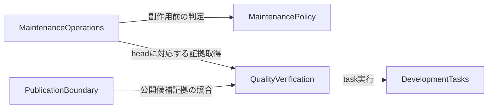

# Components

## Component Catalogue

設計案。動作は未検証。既存の開発・検証・公開コードを再利用し、保守判定と外部操作の境界を追加する。ここでのcomponentは論理的責任であり、サービスや新packageの数を意味しない。

```yaml
components:
  - name: DevelopmentTasks
    summary: Bun依存導入とローカル開発taskの入口
    behaviour: frozen導入と固定toolchainを使い、Node固有の実行境界を維持する。
    responsibilities: [依存管理, task対応, 開発手順]
    depends_on: []
    dependents:
      - component: QualityVerification
        interaction: 固定依存と開発taskを実行する
    external_dependencies:
      - name: Bun and Node
        kind: other
        purpose: 開発依存管理とNode consumer互換検証
    entities:
      - name: ToolchainDefinition
        identifier: revision
        attributes: [revision, bunVersion, nodeVersion, lockDigest, taskMap]
  - name: QualityVerification
    summary: 通常CIと重い回帰・coverageの検証証拠
    behaviour: 軽量CIと全受入れを区別し、source SHAに紐づく結果を保存する。
    responsibilities: [通常CI, commit形式検査, 回帰検証, coverage, 検証証拠]
    depends_on:
      - component: DevelopmentTasks
        interaction: 固定依存と開発taskを実行する
        style: sync
    dependents:
      - component: MaintenanceOperations
        interaction: 現在headのchecksと証拠を参照する
      - component: PublicationBoundary
        interaction: 公開候補の既存検証証拠を照合する
    external_dependencies:
      - name: GitHub Actions
        kind: other
        purpose: read権限のCI実行と結果保存
    entities:
      - name: VerificationEvidence
        identifier: runId
        attributes: [runId, sourceSha, workflowIdentity, checks, coverage, artifactDigest, conclusion]
  - name: MaintenancePolicy
    summary: 外部操作を持たない保守判定
    behaviour: 信頼元・head・証拠を共通照合し、整形と依存更新の個別条件に従い許可又は理由付き拒否を返す。
    responsibilities: [共通照合, 整形差分判定, 依存変更判定, 拒否理由]
    depends_on: []
    dependents:
      - component: MaintenanceOperations
        interaction: 副作用の前に判定を求める
    external_dependencies: []
    entities:
      - name: MaintenanceDecision
        identifier: decisionId
        attributes: [decisionId, operation, repository, headSha, evidenceIdentity, allowed, reasons]
        references:
          - entity: VerificationEvidence
            owned_by: QualityVerification
            relationship: 判定の入力証拠を識別する
  - name: MaintenanceOperations
    summary: PR情報整理と整形push・依存mergeの入口
    behaviour: 信頼した入口が外部情報を取得し、判定と操作直前のhead再照合を通過した場合だけ対象操作を実行する。
    responsibilities: [PRラベル, 更新PR設定, 外部情報取得, 整形push入口, 依存merge入口, 操作結果]
    depends_on:
      - component: MaintenancePolicy
        interaction: 副作用の前に判定を求める
        style: sync
      - component: QualityVerification
        interaction: 現在headのchecksと証拠を参照する
        style: sync
    dependents: []
    external_dependencies:
      - name: GitHub API
        kind: third-party-api
        purpose: PR情報とchecks取得及び許可された操作
    entities:
      - name: MaintenanceAttempt
        identifier: attemptId
        attributes: [attemptId, operation, headSha, decisionId, status, reason, resultingSha]
        references:
          - entity: MaintenanceDecision
            owned_by: MaintenancePolicy
            relationship: この操作を認めた判定を参照する
  - name: PublicationBoundary
    summary: 既存の承認済み公開gateと公開入口
    behaviour: Bun導入へ接続しつつ既存のsource・tarball・入力・承認・provenance照合と公開executor拒否を維持する。
    responsibilities: [公開入力照合, 承認照合, 公開executor境界, 将来の版別公開手順]
    depends_on:
      - component: QualityVerification
        interaction: 公開候補の既存検証証拠を照合する
        style: sync
    dependents: []
    external_dependencies:
      - name: npm registry
        kind: third-party-api
        purpose: 別途承認された版のOIDC公開
    entities:
      - name: PublicationInput
        identifier: bundleDigest
        attributes: [bundleDigest, sourceSha, tarballDigest, approval, provenance, evidenceIdentity]
        references:
          - entity: VerificationEvidence
            owned_by: QualityVerification
            relationship: 候補に対応する公開検証証拠を参照する
```

## Component Diagram



テキスト代替：検証は開発taskを利用する。保守操作は検証証拠を取得し、副作用のない判定を通す。公開境界は公開候補の検証証拠を照合する。判定componentから外部APIへの呼出しはない。図の構文と宣言・参照・非循環性は読み取り確認済み。レンダリングは未実施。

## Component Summary

| Component | Purpose | Depends On | Dependents | Entities Owned |
|---|---|---|---|---|
| DevelopmentTasks | Bun導入とtask | なし | QualityVerification | ToolchainDefinition |
| QualityVerification | source対応検証とcommit形式検査 | DevelopmentTasks | MaintenanceOperations, PublicationBoundary | VerificationEvidence |
| MaintenancePolicy | 副作用なしの許可判定 | なし | MaintenanceOperations | MaintenanceDecision |
| MaintenanceOperations | PR保守と書込み入口 | MaintenancePolicy, QualityVerification | なし | MaintenanceAttempt |
| PublicationBoundary | 既存公開gate | QualityVerification | なし | PublicationInput |

## Entity Ownership

各entityの所有者・identifier・属性・参照は上のcatalogueに一意に定義する。永続DBの新設を意味せず、既存ファイル・workflow入力・メモリ上の判定を表す。

| Entity | Owning Component | Identifier | Attributes | References |
|---|---|---|---|---|
| ToolchainDefinition | DevelopmentTasks | revision | bunVersion, nodeVersion, lockDigest, taskMap | なし |
| VerificationEvidence | QualityVerification | runId | sourceSha, workflowIdentity, checks, coverage, artifactDigest, conclusion | なし |
| MaintenanceDecision | MaintenancePolicy | decisionId | operation, repository, headSha, evidenceIdentity, allowed, reasons | VerificationEvidence |
| MaintenanceAttempt | MaintenanceOperations | attemptId | operation, headSha, decisionId, status, reason, resultingSha | MaintenanceDecision |
| PublicationInput | PublicationBoundary | bundleDigest | sourceSha, tarballDigest, approval, provenance, evidenceIdentity | VerificationEvidence |

## External Dependencies

| Component | Dependency | Kind | Purpose |
|---|---|---|---|
| DevelopmentTasks | Bun and Node | other | 固定依存と互換境界 |
| QualityVerification | GitHub Actions | other | 検証と証拠 |
| MaintenanceOperations | GitHub API | third-party-api | PR保守と許可済み操作 |
| PublicationBoundary | npm registry | third-party-api | 個別承認後の公開 |

## Rationale

| 境界 | 理由 |
|---|---|
| 開発と検証 | ローカルtaskの成功とsourceに対応するCI受入れ証拠は異なる責任 |
| 判定と操作 | 書込み権限なしの拒否試験と、操作直前のhead照合を分離する |
| 通常CIと公開 | 通常CIには公開権限も公開許可の意味も与えない |

Option Aは共通照合を共有し、整形pushと依存mergeを別入口にする。重複を減らす一方、共通判定の変更が両方に影響するため両入口の拒否回帰が必要。Option Bは各入口が判定も持つため単体の変更は閉じるが、headや証拠の照合が重複し条件がずれる。両案は内部移動で可逆。人間のQ1回答Aに従いOption Aを採用する。Alternatives Rejected：Option Bは照合の重複と乖離のため採用しない。

## Boundary Rules

FR5のcommit形式検査はQualityVerificationが担当する。PRの検査対象commitを現在headに対応づけ、定義した形式を検査して、成功・不成立の結果をVerificationEvidence.checksに含める。不成立をCI成功や検査skipとして扱わない。commitメッセージをshell命令として解釈しない。MaintenanceOperationsはPRラベル付与を担当し、依存merge入口ではこの検査を含む現在headの必要checksを参照する。具体的な検査対象範囲・形式・check名は後続設計で確定する。

整形は固定された信頼済みformatterとconfigで、credentialなしの環境で完全な差分を再現する。PR由来config・scriptをwrite権限で実行しない。差分不一致・整形以外・fork・stale head・改変証拠・削除済みbranchならpush起動0回。

依存mergeは認証済み更新bot、allowlist内の安定版dev依存patch/minor、直接依存変更ちょうど1件、再現したlock差分、現在headの全必要checks成功が必須。0件・2件以上・major・prerelease・Actions更新・公開境界・無関係差分・不足証拠ならmerge起動0回。外部入口はexpected headに対する条件付き操作を要求し、APIがその条件を保証できなければ操作を拒否する。

軽量CIの証拠を公開回帰・coverage証拠に読み替えない。統合前には今回のSHAに対応する実CIと固定第一者JS coverage80%以上を必要とする。Node/browser consumer、worker、既存timeout・1worker・retryなし・wasm上限を維持する。RCタグ・固定入力・dist-tagは変更しない。

## Sources

- ../requirements-analysis/requirements.md：FR1–FR9、NFR1–NFR5の承認済み条件。
- ../practices-discovery/team-practices.md：Bun、別intent、最小権限と品質基準。
- aidlc/spaces/default/codekb/formicarium/architecture.md：Bun / CI focused scanの開発・検証・公開境界。
- aidlc/spaces/default/codekb/formicarium/component-inventory.md：既存componentの再利用範囲。
- domain-design-questions.md：Q1回答A。
