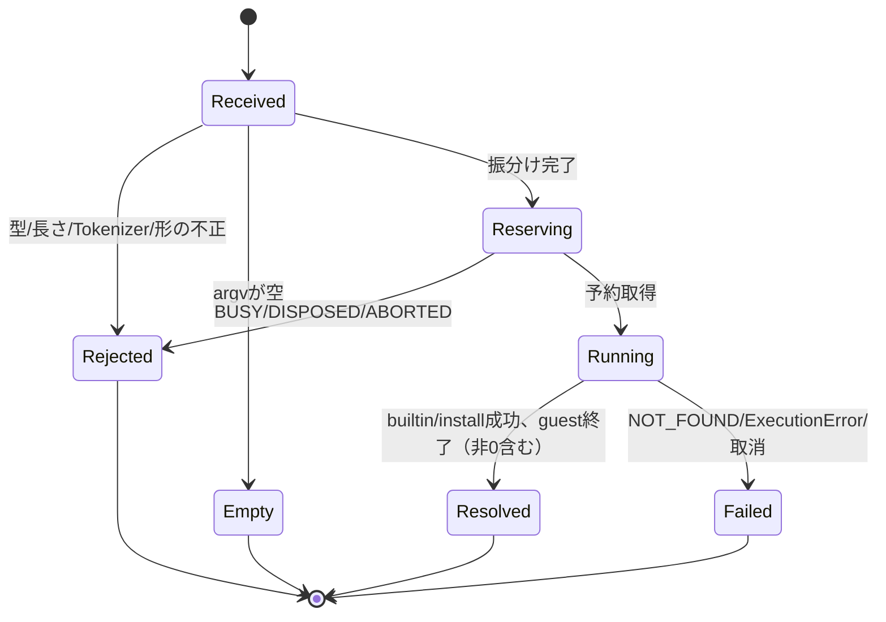
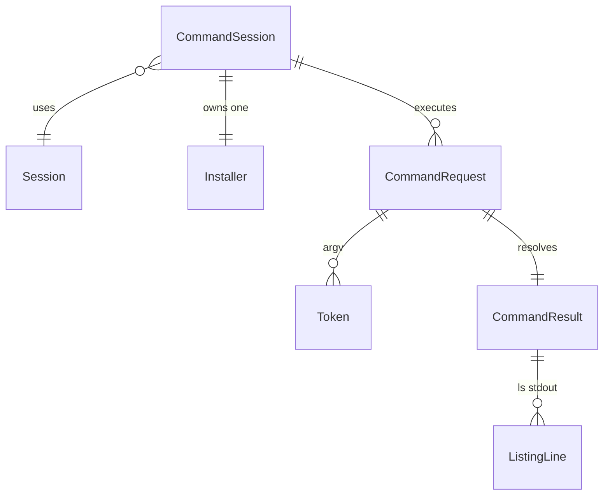

# commandの機能仕様

## Sources

根拠は承認済み `../../../inception/units-generation/unit-of-work.md`（U4：argv分割、ls/cat/rm -rf/cd、guest runとinstallの振分け、transcript整形、導入処理を複製しない）、`../../../inception/units-generation/unit-of-work-story-map.md`（FR3はU4が完結、FR5はU4がcommand経由の競合を検証、NFR7）、`../../../inception/requirements-analysis/requirements.md`（FR3/FR5/NFR3/NFR7）、`../../../inception/domain-design/components.md`（CommandSession、CommandRequest、状態と取消の所有）、`../../../inception/contract-design/contract-summary.md`（C02/C04/C05/C11、Transcript）、本stageのQ1–Q4=A。entityは `entities.md`、ruleは `rules.md` のYAMLが正本である。以下はドキュメント根拠で、実行は未検証。

## 責任と境界

CommandSessionは文字列1行を解釈し、U2（ExecutionSession）とU3（InstallCoordinator）の既存操作へ振り分ける。cwd・FS・登録guestを複製せず、取得・展開・検証を再実装しない（unit-of-workの制約）。公開APIはC05の `createCommandSession(session, { catalog })` と `execute(input, options)` だけで、U2/U3と同じ配布物に入るが別moduleとして検証する。transcriptの文字列化と表示上限はUI（U6/U8）の責任で、U4の結果bytesは原本である（BR4.17）。

## Workflow W1：execute

1. 入力の型と長さを確認する。文字列でない、またはUTF-8で65537 bytes以上なら INVALID_INPUT（BR4.2）。
2. Tokenizer（W2）でargvを作る。失敗は INVALID_INPUT で、予約を取らない（BR4.4–BR4.7、BR4.15）。
3. argvが空なら kind=empty、exitCode 0、空bytesでresolveする。予約は取らない（BR4.3）。
4. argv[0]で振り分ける（BR4.8）。
   - `ls` `cat` `rm` `cd` → W3（builtin）
   - `install` → W4（install）
   - それ以外 → W5（guest run）
5. 各経路はU2の予約を1度だけ取得し、終了時に解放する。activeな予約があれば BUSY、dispose後は DISPOSED、取消は ABORTED で、既存状態を変えない（BR4.10）。
6. 結果を新しいbytesのCommandResultとして返す。HTML/codeとして評価しない（BR4.17）。

## Workflow W2：Tokenizer

状態は `none`（引用外）、`single`、`double`、`escape`（引用外のbackslash直後）、`dq-escape`（二重引用内のbackslash直後）の5つ。

1. 入力をcode point単位で読む。LF・CR・NULは全状態で拒否する（BR4.4）。
2. `none`：space/tabは現在のTokenを確定する（連続は1区切り、先頭と末尾は無視）。`'` → `single`、`"` → `double`、`\` → `escape`。`| & ; < > $` backtick `* ? ( ) { }` は拒否する（BR4.5）。それ以外の文字はTokenへ追加し、非ASCIIやNBSPは変形しない。
3. `single`：`'` で `none` に戻る。それ以外はliteral。
4. `double`：`"` で `none` に戻る。`\` → `dq-escape`。`$` やbacktickもliteral（BR4.6）。
5. `dq-escape`：次の文字が `"` か `\` ならその1文字を追加する。それ以外なら `\` とその文字の2文字を追加する。`double` に戻る。
6. `escape`：次の文字を1文字そのまま追加する（区切りや記号も含めliteral）。`none` に戻る。
7. 入力の末尾で `single`・`double`・`dq-escape` なら「unterminated quote」、`escape` なら「trailing backslash」で拒否する（BR4.7）。
8. 引用を開いた時点でTokenは存在する扱いにし、`''` や `""` は空文字のTokenになる。隣接する引用部分と非引用部分は1つのTokenに連結する。

例（期待値）：
| 入力 | argv |
|---|---|
| `cat "a b.txt"` | `cat`, `a b.txt` |
| `aube 'x;y' ""` | `aube`, `x;y`, `` |
| `aube "say \"hi\" \\ \n"`（二重引用内の `\n` は2文字） | `aube`, `say "hi" \ \n` |
| `cat a\ b` | `cat`, `a b` |
| `aube "$HOME"` | `aube`, `$HOME` |
| `ls *` | INVALID_INPUT |
| `aube "unclosed` | INVALID_INPUT |
| `cat file\` | INVALID_INPUT |
| `cat 日本語　名.txt`（全角空白） | `cat`, `日本語　名.txt` |

## Workflow W3：builtin

1. 形を確認する：`ls` は引数0か1（`-` で始まる引数は拒否）、`cat path`、`cd path`、`rm -rf path`。それ以外は予約前に INVALID_INPUT（BR4.9）。
2. `cat` `cd` `rm`：C02 `acquire('fs')` → `builtin(reservation, argv)` → `release`。cat は原本bytesをstdoutへ、cd と rm は空のstdout（BR4.10）。
3. `ls`：公開 `listEntries(path)` を1回呼ぶ（内部でfs予約を1回取得し、直接APIと同じ排他）。返ったentryをW6で整形する（BR4.11）。
4. pathの正規化とcwd基準の解決はU2が行い、U4はhostのFSへアクセスしない（BR4.16）。U2の NOT_FOUND などはそのままrejectする。
5. 成功時は kind=builtin、exitCode 0、stderrは空。

## Workflow W4：install

1. 引数が1つでなければ INVALID_INPUT（BR4.12）。
2. factoryで作った内部Installerの `install(selection, { signal, onProgress })` を呼ぶ。予約・選択検証・取得・検証・登録・取消はC04が行い、U4は複製しない。
3. 成功時は kind=install、exitCode 0、stdoutは `installed <tool>@<versionOrName> (sha256 <digest>)` と改行、installationにInstallResult。失敗はC04のエラーをそのままrejectし、旧登録はC04により保持される。

## Workflow W5：guest run

1. C02 `acquire('run')` で予約する（BR4.10）。
2. `runInstalled(reservation, argv[0], argv.slice(1), { signal, onOutput, ... })` を呼ぶ。未登録なら NOT_FOUND（BR4.13）。
3. RunResultが返れば、exitCodeが非0でも kind=guest でresolveする。stdout/stderr/runIdはcopyする。ExecutionErrorはそのままrejectする（BR4.14）。
4. 成功・失敗にかかわらず `release` する。

## Workflow W6：lsの表示

1. listEntriesのentryから最後のpath要素を名前とする。
2. 名前のUTF-16 code unit順で並べる（terrariumの `.sort()` と同じ）。
3. dirは `name/`、symlinkは `name -> target`、fileは `name` とし、各行の末尾に改行を付ける。
4. entryが0件ならstdoutは空のbytes（BR4.11）。

## State Machine：CommandRequest

<!-- Text fallback: CommandRequestはReceivedから、不正入力ならRejected、空ならEmpty、振分け後はReservingへ進む。予約できなければRejected、できればRunningになり、成功またはguest終了でResolved、エラーや取消でFailedとなる。Rejected/Empty/Failedでは状態を変えない。 -->

RejectedとEmptyでは予約を取らない。Failedでは予約を解放し、U2の失敗契約によりFS・cwd・登録は変わらない（BR4.15）。

## Entity-Relationship（entities.mdから派生）

<!-- Text fallback: CommandSessionは1つのSessionを使い、Installerを1つ所有し、複数のCommandRequestを実行する。CommandRequestは複数のTokenからなるargvを持ち、1つのCommandResultを返す。lsのCommandResultのstdoutは複数のListingLineからなる。 -->

## Rules Summary（rules.mdから派生）

| 分類 | rule |
|---|---|
| 入力検証 | BR4.2（長さ）、BR4.4（区切り/改行）、BR4.5（shell記号）、BR4.7（未閉引用/末尾backslash）、BR4.9（builtinの形）、BR4.12（installの引数）、BR4.13（未登録） |
| 解釈 | BR4.3（empty）、BR4.6（引用/escape）、BR4.8（振分け）、BR4.11（lsの表示） |
| 状態と排他 | BR4.1（factory）、BR4.10（予約）、BR4.15（拒否時不変）、BR4.16（guest path） |
| 結果 | BR4.14（guest終了）、BR4.17（原本bytes） |

## 試験観点（Code Generationへの入力）

unit-of-workの合格証拠に対応させる：空入力、空白・引用・非ASCII（W2の例表）、未閉引用・shell構文・不正引数・未登録command、連続操作でのcwd/FSの維持（cd→ls→cat→rm→ls）、install/runの競合（直接APIとの BUSY）、install失敗後の旧登録保持、65536/65537 bytesの境界、ls表示の並べ替え・記号・空。Node/3ブラウザのconsumerで同じ公開APIを確認する。U4の完了にはU2/U3/U4のB1統合受入（C06）を含む。

## Assumptions & Open Questions

None.
