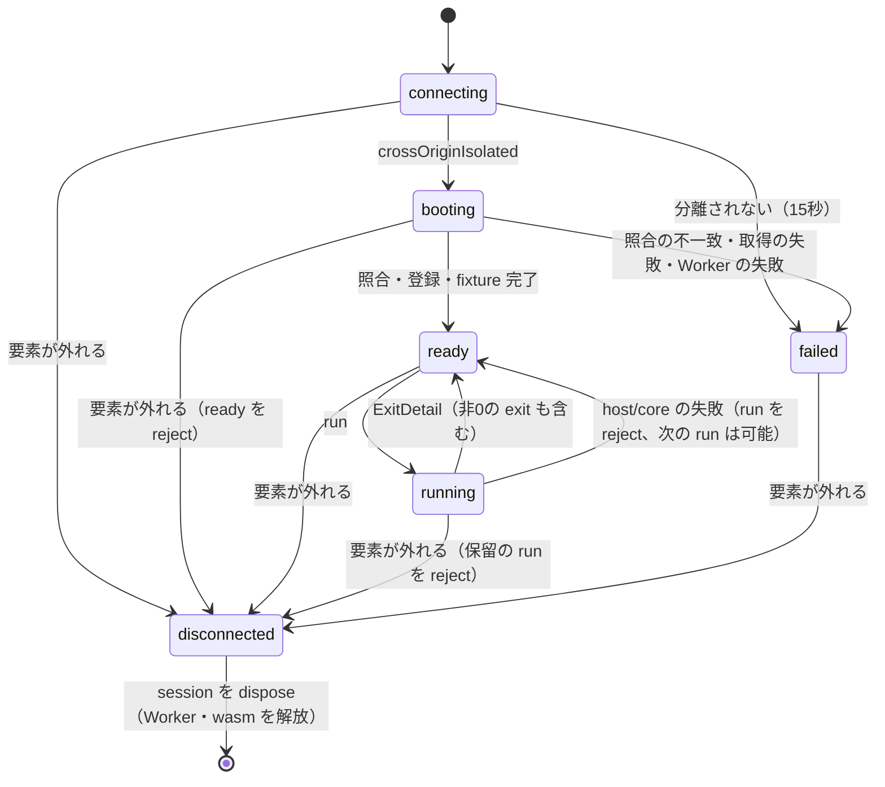
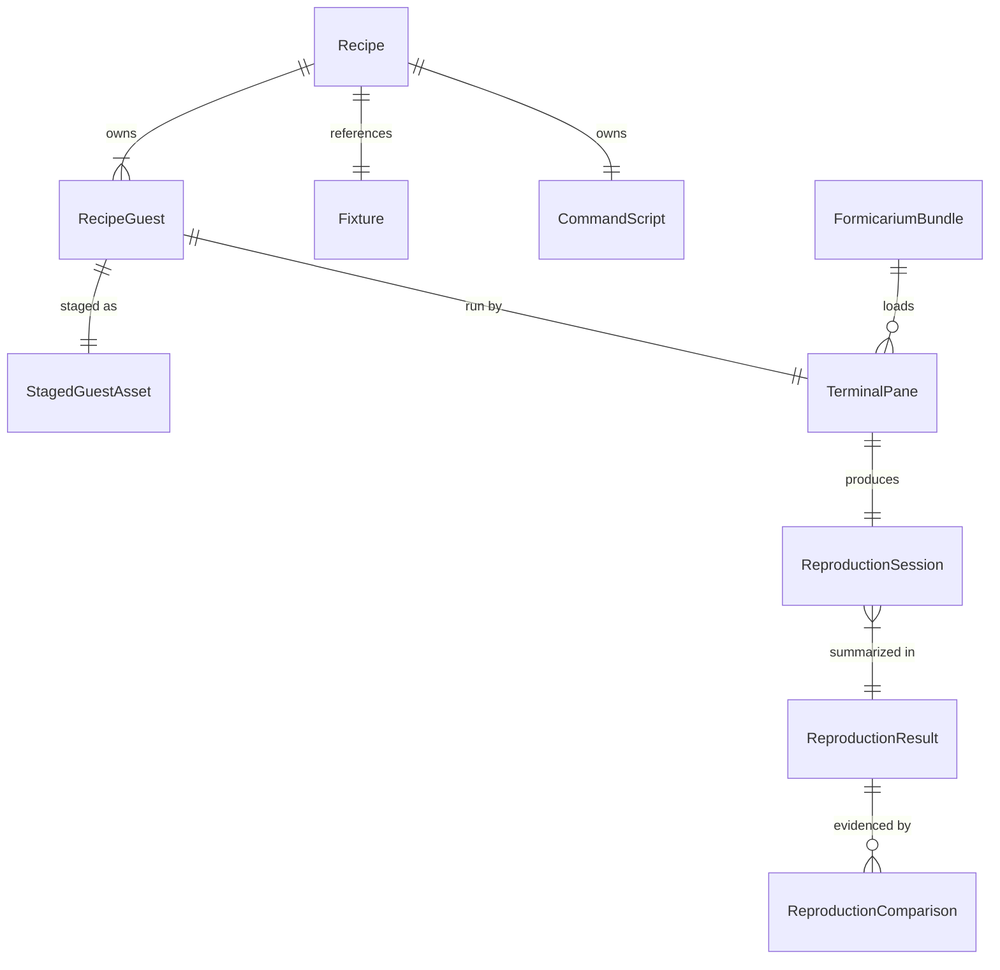

# U6 recipe-runtime の機能仕様

## Sources

- `functional-design-questions.md`（Q1–Q11、人間の回答 2026-10-18）、`entities.md`、`rules.md`
- `../../../inception/units-generation/unit-of-work.md`（U6）、`unit-of-work-story-map.md`（FR10–FR12）
- `../../../inception/requirements-analysis/requirements.md`、`../../../inception/contract-design/contract-summary.md`（どちらも 2026-10-18 の改訂節を含む）
- vivarium の読取り調査（ローカル main = `71e0ef92`、2026-10-18）と、`JamBalaya56562/biome` の branch `fix/migrate-prettier-override-bracket-spacing`（`25e3e2c2`）の読取り

User Stories は生成されていないので、要件ID（FR10–FR12）と規則ID（BR）へ直接対応させる。この資料は設計で、vivarium・formicarium の実装や動作の主張ではない。baseline で `bracketSpacing` が落ちることは fix の差分から読んだ推測で、未実行。

## 範囲と、承認済み文書からの変更（2026-10-18、人間の決定）

U6 は、vivarium の再現 recipe を formicarium runtime で動かす最初の recipe を作り、vivarium の terrarium の現役参照を消す。

承認済みの要件と契約は「terrarium の recipe（biome-12265）を移す」前提だったが、vivarium の調査で前提が変わっていた（biome-12265 は #518 で削除済み、terrarium を使う recipe は0件）。人間の回答で次のように変える。`requirements.md` と `contract-summary.md` に、同じ日付の改訂節を足した。

| 承認済みの内容 | 変更後（人間の回答） |
|---|---|
| FR11：biome-12265 の asNeeded/single → always/double を旧verdictと比べる | 題材を `JamBalaya56562/biome` の `fix/migrate-prettier-override-bracket-spacing` にする（Q1）。旧verdictは無いので、before（baseline）と after（fix）の比較を固定した証拠にする |
| FR9・C10：baseline `2405c762`・fix `f79f85d5` | baseline は作成時点の biomejs/biome main を40桁へ解決した値（Q10=B）、fix は fork branch の先頭（今は `25e3e2c2`）。旧題材の Release 2件と vivarium の build残骸は消す（Q8=A）。U5 の証拠と記録は残す |
| FR12・C08：runtime.name=formicarium を受け付け、terrarium を deprecated互換として残す | terrarium は現役の値から外し、互換の adapter は作らない（Q6=A。人間の補足「terrariumは完全削除の予定」） |
| C08：DOM event と iframe bridge の互換 | ready・run・transcript だけ（Q7=A） |
| C08・FixedGuestDeclaration：同じtoolは1件 | `guests[]` に role（baseline/fix）を足す（Q2=A） |
| C08 `RecipeGuest`：commit と digest を同じ階層に持ち、bump は digest を消す | build 入力の `commit` と、受入済みの `accepted`（commit・buildKey・digest）を分ける。bump は `commit` だけを動かし、site は `accepted` で動き続ける（Q12=A）。`accepted` か formicarium の pin が無い recipe は pending で、他を止めずに site から外す |
| C10 の U6 profile の check 名 `biome-12265-comparison` | `reproduction-comparison` に改める |

recipe の名前は `biome-migrate-override-bracket-spacing`（issue番号なし、Q9=B）。biomejs/biome に issue が立ったら `biome-<番号>` へ改名する。

## Workflows

### W1. recipe の作成と固定入力（作者、vivarium の PR）

1. 作者は `src/layer1_wasm/biome-migrate-override-bracket-spacing/` に recipe.json・README・page・repro・i18n・`fixture/`（`.prettierrc` と `biome.json`）・coi-serviceworker.js（v0.1.7、BR2.4）を作る（vivarium の recipe 作成の規則）。
2. recipe.json に `expected_runtime: "formicarium"` と `guests[]` の2件を書く（BR1.1・BR1.2）。
   - baseline：`role: baseline`、`tool: biome`、`repository: https://github.com/biomejs/biome`、`commit` = その時点の main を40桁へ解決した値、`reference.branch: main`（BR1.5）。
   - fix：`role: fix`、`repository: https://github.com/jambalaya56562/biome`、`commit: 25e3e2c2d97c5e1780d10833c9f63fc6dce0f8a9`、`reference.branch: fix/migrate-prettier-override-bracket-spacing`。
   - 両方とも `fixture: biome-migrate-prettier-override`。`accepted` はまだ無い。`fix_candidate` は書かない（BR1.8）。
3. schema 検証と recipes index の生成が、上の規則を確かめる（BR1.1–BR1.4・BR1.8）。`accepted` が無いので recipe は pending で、site と回帰試験から外れる（BR1.7）。この PR は他の recipe を止めないので merge できる。
4. merge の後、上流の fixed-guest-build が main の recipe の各 role の `commit` を build し、承認を受けて Release（tag `guest-biome-<buildKey>`）へ置く（U5 の経路、C07）。
5. 人が Release の build-info を確かめ、各 guest の `accepted`（commit・versionOrName・buildKey・ELF と build-info の digest）を書く PR を作る（BR1.6）。formicarium の pin file もあれば、recipe は active になる。
6. formicarium 0.3.0 の公開の前は pin file を置かない。recipe は pending のままで、試験はローカル tarball で行う（BR2.1）。公開後に、人が pin file を足す PR を作る。

### W2. 固定入力の更新（上流の fixed-guest-bump）

1. 人が bump を dispatch する（今のとおり。入力は recipe と role）。bump は role で guest を選ぶ（BR1.2）。
2. baseline は biomejs/biome の `main`、fix は fork branch の先頭を直接解決する（PR の情報は使わない）。
3. 先頭が動いていれば、その guest の `commit` だけを更新した PR を作る（branch 名 `fixed-guest-bump/<slug>-<role>`）。`accepted` は変えない。merge は人が行う。
4. merge の後、新しい `commit` で W1 の 4–5 をやり直す。その間も site は前の `accepted` の guest で動く（BR1.4、Q12=A）。
5. 新しい `commit` の build が失敗したら、`accepted` は前のままにし、失敗を記録して人の判断に回す（BR1.5）。

### W3. site build（vivarium の deploy）

1. pin file があれば、formicarium の npm 固定版 tarball を取り、SHA256 と entry の path を確かめて、一覧の file（notices を含む）を site の同じ origin の1か所へ置く（BR2.1・BR8.1）。
2. active の各 recipe の各 guest について、`accepted.buildKey` の Release から ELF・build-info・catalog を取り、digest と build-info の identity を `accepted` と照合して、同じ origin へ置く（BR2.2・BR2.3）。
3. coi-serviceworker.js の digest を確かめ、recipe の page（en と ja の写し）に置く（BR2.4）。
4. pending の recipe は外し、index 生成の出力に理由を記録する（BR1.7）。
5. active の recipe の取込み・照合のどれかが失敗したら build を失敗させ、前回の site を保つ。

### W4. ブラウザでの再現（訪問者・回帰試験）

1. page を読み込む。`crossOriginIsolated` でなければ coi-serviceworker で再読込を待つ（最大15秒、BR3.1）。
2. baseline、fix の順に端末を起動する（BR3.7）。各端末は：
   1. formicarium の browser用 module を同じ origin から読み、session を作る。
   2. 同じ origin から ELF と build-info を取り、C03 で `accepted` の digest・identity と照合する（BR3.2）。
   3. fixture の file を C03 の FsEntry（/work と /work/app は dir、各 file は file）に変え、初期FSにする（BR3.3）。
   4. 検証済み guest を tool 名 `biome` に登録し、その guest の catalog で command session を作る（BR3.3）。
   5. ready を resolve する（`{tool, ref, commit, seconds}`。ref は reference.branch、commit は検証済み build-info の値。BR3.6）。
3. 各端末で command 列を順に実行する。この間、訪問者の入力は受け付けない（BR3.4）。
   1. `cat .prettierrc` と `cat biome.json` で fixture を確かめる（BR4.1）。
   2. `biome migrate prettier --write` の exit を確かめる（BR4.2）。
   3. `cat biome.json` の出力から、`*.js` の override の `bracketSpacing` を読む（BR4.3）。
4. baseline の結果で verdict を決め、fix の結果を fix の pane の状態にする（BR4.4）。起動・照合・実行・解析の失敗は判定ではなく、原因を baseline_error・fix_error と page の文に出す（BR4.5）。
5. Result v1 envelope を set する（BR4.6）。そのあと、訪問者の入力を有効にする。

### W5. 受入（U6 の証拠）

1. main session が、Chromium・Firefox・WebKit で W4 を1回ずつ実行する（1 worker、retry 0）。分離の下で Worker が起動すること、2端末を動かせることも観測する（BR3.1・BR3.7）。
2. 各ブラウザで、fixture・command の digest（BR5.3）、before・after の stdout・設定の digest、exit、verdict、override の bracketSpacing を ReproductionComparison として記録する（BR5.1）。合否は override の field で決める。
3. C10 の AcceptanceEvidence にまとめ、U6 の profile の必須check（reproduction-comparison など）と coverage-80（BR5.4）を満たすことを確かめる（BR5.2）。

### W6. terrarium と旧題材の整理（U6 の code generation）

1. vivarium の terrarium の現役参照を、BR6.1 の一覧どおりに消す。coi-serviceworker の写しの仕組みは terrarium の名前から切り離して残す。最後に検索で、残りが歴史の説明だけであることを確かめる。
2. recipe schema と Contract v1（en/ja）を同じページの revision で直す（BR6.2）。
3. 上流の fixed-guest-bump を、role で選び、`commit` だけを動かし（`accepted` は消さない）、branch 名と title に role を含めるように直す。上流の fixed-guest-build も role ごとに build できるようにする（BR1.2・BR1.4。上流 vivarium の変更）。
4. 旧題材の Release 2件と tag（BR6.3 の対応表）の一覧を示し、個別の承認を受けてから、書込み権限のある人が消す。vivarium の build残骸も消す。承認と実行を記録する。

## State machine：TerminalPane

テキスト代替：connecting から、分離されれば booting、15秒で分離されなければ failed。booting から、照合・登録・fixture が済めば ready、失敗すれば failed（ready を reject）。ready で run が来れば running、終われば ready へ戻る（guest の非0終了は resolve、host/core の失敗は reject で、次の run はできる）。どの状態からでも、要素が外れれば disconnected になり（booting なら ready を reject、running なら保留の run を reject、古い応答は表示しない）、session を dispose して Worker と wasm を解放する。判定の command 列の間は、ready・running のどちらでも訪問者の入力を受け付けない（BR3.4）。

## Entity relationship（`entities.md` の YAML から導いた図）

テキスト代替：Recipe は RecipeGuest（1〜2件）と CommandScript を持ち、Fixture を参照する。RecipeGuest は site 配下の StagedGuestAsset として置かれ、TerminalPane で動く。TerminalPane は ReproductionSession を作り、それが ReproductionResult にまとまる。受入では ReproductionComparison がそれを証拠にする。FormicariumBundle は各 TerminalPane が読む。

## Rules summary（`rules.md` から導いた要約）

| ID | 要点 |
|---|---|
| BR1.1–BR1.8 | guests[] 必須、role で区別、宣言の規則、build 入力の commit と受入済みの accepted を分ける、baseline は main を bump で追う、accepted の置き換えは人の PR、active と pending、fix_candidate を使わない |
| BR2.1–BR2.4 | pin file の固定版から同じ origin へ、accepted.buildKey の Release を照合、C11 の上限、coi-serviceworker の固定 |
| BR3.1–BR3.7 | COI、実行前の再照合、fixture の FsEntry 変換と command、run の逐次化と入力の無効化、transcript の上限、ready/run/transcript だけ、起動の順と dispose |
| BR4.1–BR4.6 | 事前確認、exit、override の bracketSpacing（2か所）、baseline だけで verdict、失敗は判定ではない、Result v1 |
| BR5.1–BR5.4 | 3ブラウザの比較、C10 の identity、digest の正規化、coverage-80 の分母 |
| BR6.1–BR6.3 | terrarium の現役参照の除去（一覧）、schema・Contract v1 の revision、旧題材の Release の削除（個別承認） |
| BR7.1–BR7.2 | 出力の escape と入力の保持、状態の文字表示と keyboard |
| BR8.1 | formicarium・coi-serviceworker・Biome の license |

## 失敗と境界の場合

| 場合 | 振る舞い | 規則 |
|---|---|---|
| recipe に guests が無い・role の重複・accepted が一部だけ | index 生成を失敗させる | BR1.1・BR1.2・BR1.4 |
| accepted が無い（最初の PR・新しい recipe）、pin file が無い（0.3.0 の公開前） | その recipe は pending。他の recipe の build・回帰試験は続け、公開 site に載せない。合格とも扱わない | BR1.7 |
| bump で commit が動いた | site は前の accepted の guest で動き続ける。新しい build と人の PR の後に accepted を置き換える | BR1.4・BR1.6 |
| 新しい commit の build が失敗した | accepted は前のまま。失敗を記録し、人の判断に回す | BR1.5 |
| tarball・coi-serviceworker・Release の digest が違う、tarball の entry が不正、取得が上限・期限を超える | build を失敗させる。別の tag・latest・CDN で代わりにしない。前回の site を保つ | BR2.1–BR2.4 |
| page が分離されない | 端末は failed。判定ではなく、原因を出す | BR3.1・BR4.5 |
| 同じ origin の ELF が build 後に変わった | C03 の照合で拒否し、実行しない | BR3.2 |
| fixture が改変された・migrate が失敗した・JSON が解析できない | その session は error（判定ではない） | BR4.1–BR4.3・BR4.5 |
| baseline（最新の main）でも corrected になる | verdict は unreproduced。受入では「main で直っている」と記録し、人間の判断に回す | BR4.4・BR5.1 |
| main が別の場所（javascript.formatter）へ移す形で直す | corrected と読む | BR4.3 |
| 判定の command 列の途中で訪問者が入力する | 受け付けない（列が終わるまで入力は無効） | BR3.4 |
| 2端末を動かすとメモリが足りない | 後から起動した pane を error にする。3ブラウザで観測する | BR3.7 |
| 同じ端末で run を続けて呼ぶ | 呼んだ順に1件ずつ実行する | BR3.4 |
| 出力が表示の上限を超える | 表示の先頭を捨てる。判定は原本の output から | BR3.5 |

## 依存と所有

- U6 は formicarium の公開 API（C03 の guest・fixture 検証と登録、C05 の command）を使うだけで、formicarium の内部には依存しない。
- 固定 guest の build・Release は U5（上流 vivarium の fixed-guest-builder）が所有する。U6 は role の対応と、`commit` と `accepted` を分ける bump の変更を上流 vivarium に足す。
- formicarium 0.3.0 の npm 公開は U2〜U4 の範囲で、U6 の site への公開はその後。公開前は pin file を置かず、試験用にローカル tarball を使う。
- terrarium repository 自体の退役は U9（FR16）の範囲。

## 実機 Safari

実機 Safari は、別の証拠が無ければ未検証と表示する。WebKit の結果を実機の合格としない。
