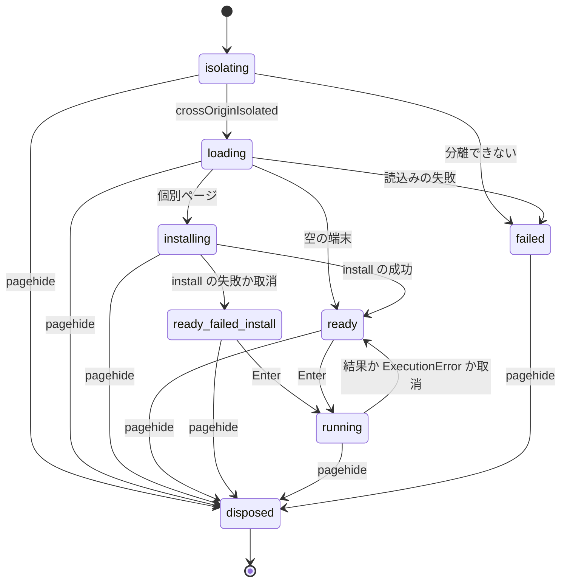
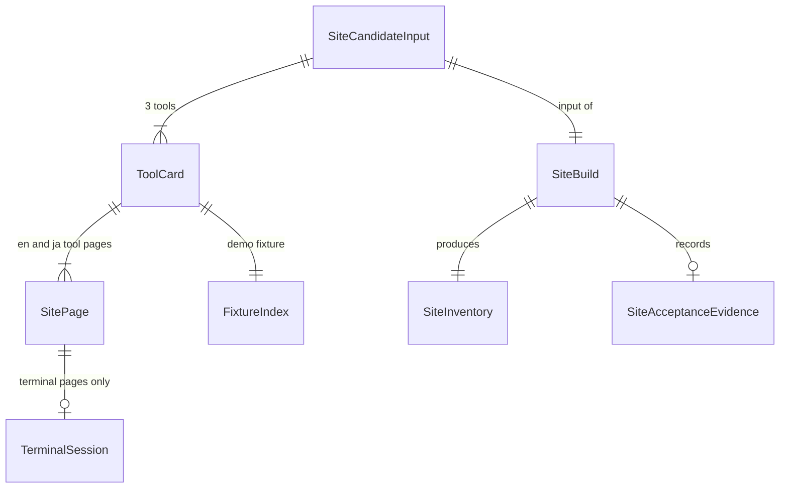

# U8 showcase-site の機能仕様

## Sources

- 人間の回答：`functional-design-questions.md`（Q1–Q7、2026-10-19、Guide me）
- 単位：`../../../inception/units-generation/unit-of-work.md`（U8：Astro/Starlight のカード、トップの説明、/tools/、空の端末の install、個別ページ、日次の候補の受入と Pages の配布の準備）、`../../../inception/units-generation/unit-of-work-story-map.md`（FR15 の主担当）
- 要件：`../../../inception/requirements-analysis/requirements.md`（FR15、NFR5–NFR8）
- 部品：`../../../inception/domain-design/components.md`（Showcase：サイトの消費。ShowcaseCandidate）
- 契約：`../../../inception/contract-design/contract-summary.md`（C03 公開 fixture・guest の検証、C04 install、C05 command、C09 候補の供給、C10 の U8 の profile と SiteEvidenceIdentity、C11 上限、「Transcript の表示と原本」）
- 同じ dir の `entities.md`（source of truth：data の形）と `rules.md`（source of truth：判断の規則）、`frontend-components.md`
- 既存の実装の読取り（2026-10-19）：formicarium の `showcase/`（U7：`scripts/{candidate,catalog,pack,mode,boundary,tls,accept-server}.ts`、`tools.json`、`trusted-callers.json`、`b1-pack.json`）と `.github/workflows/showcase.yml`、`types/index.d.ts`（公開 API）、terrarium の upstream main `2caa5706` の `docs/` と `packages/terrarium/src/terminal.ts`

この資料は設計で、実装・動作の主張ではない。Pages の有効化、Astro・Starlight・xterm の最新版での動作、3ブラウザでの分離、CSP と Starlight・xterm の両立は未検証。

## 範囲

| 含む | 含まない |
|---|---|
| `showcase/site/`（Astro と Starlight の site と、その build・検査・受入の script）、`.github/workflows/showcase-site.yml`（日次 build と配布）、site の受入と C10 の U8 の証拠 | ツールの解決・取得・build・catalog・候補（U7）、demo の追加、terrarium の Pages の案内への変更（U9） |
| 英語と日本語の全 page（Q2=B） | terrarium の `<terrarium-terminal>` 要素・iframe の bridge・npm と JSR の package（Q7=A） |
| terrarium の guides 6ページの formicarium 向けの書き直し（Q3=C） | Pages の有効化と `github-pages` environment の設定そのもの（後の工程で、内容を示して承認を受けてから） |

page の一覧（base `/formicarium`、日本語は `/ja/` の下に同じ形）：

| path | kind | 内容 | 端末 |
|---|---|---|---|
| `/` | top | エミュレータの説明（hero と短い本文）、/tools/・/terminal/・guides への導線 | なし |
| `/tools/` | tools | 3ツールのカード（tool、版、説明、個別ページへの link）、/terminal/ への link | なし |
| `/tools/<tool>/` | tool | 導入済みの端末（Q5=A） | あり |
| `/terminal/` | terminal | 空の端末（Q4=A） | あり |
| `/guides/getting-started/` ほか5ページ | guide | BR2.4 の6ページ | なし |

## Workflows

### W1. site の build（showcase-site.yml の build の job）

1. 候補を受け取る：`showcase.yml` を `workflow_call` で呼ぶ。mode は BR1.3 の規則（main からの schedule・workflow_dispatch は distribute、他は verify）。`candidate` job の成功、出力 `candidate-id`・`distributable`、artifact `showcase-candidate`（`manifest.json`、`site/`、`acceptance-log.json`、`resolutions.json`）と `showcase-work-resolve`（`pack/`）を取る（BR1.1）。
2. 照合する：BR1.2 の (1)〜(7)。candidateId と fixture の inventory は U7 が export する関数で計算し直す。
3. 配置する（BR5.1）：
   - formicarium：pack を確かめて展開し、公開 export から辿れる module・単一 file の Worker・assets・LICENSE・THIRD_PARTY_NOTICES.md を `_formicarium/<version>/` に bytes のまま置く。
   - guest と catalog：候補の `site/`（`catalog.json` と `guests/<tool>/<version>/`）を bytes のまま site の root に置く。
   - fixture：各ツールの fixture の index（`entities.md` の FixtureIndex）を作って置く（BR3.2）。
   - coi-serviceworker の写しを site の root に1つ置く（BR5.2）。
4. page を作る：カードと個別ページを manifest・`showcase/tools.json`・site の文言 file から作り、Starlight の文書（en・ja）を build する（BR2.1–BR2.4）。embedding の code の例を、pack の版の型で型検査する（BR2.4）。
5. site の identity の file（run_number・sourceCommit・candidateId と、inventory の SHA256）を置く（BR6.2）。inventory はこの file を除いて計算する。
6. 検査する：全 page が en・ja の両方にあること、cross-origin の副資源が無いこと（BR4.3）、端末の page の CSP（BR5.3）、dotfile、大きさ 1073741824 bytes 未満、third-party の notices（BR5.4）、公開 import の境界（BR3.1）。
7. Pages の artifact を1回だけ作り（upload-pages-artifact、dotfile を含める）、inventory を記録する（BR6.3）。

### W2. site の受入（受入の job）

1. W1 の Pages の artifact を取って展開し、inventory を計算し直して W1 の値と一致することを確かめる（BR6.3）。
2. header を付けない静的 server で、base `/formicarium`、job 専用の CA の HTTPS で配る（BR7.1）。
3. Chromium・Firefox・WebKit を1つずつ、1 worker・retry 0 で、BR7.1 の (1)〜(6) を行う：
   - (1) 空の端末（`/terminal/`・`/ja/terminal/`）で3ツールの install と `--version`。
   - (2) 個別ページ（`/tools/<tool>/`・`/ja/tools/<tool>/`）が導入済みで始まり、`ls`・`cat`・`<tool> --version` の出力が1回ずつ出る。
   - (3) 状態の表示と keyboard。
   - (4) 分離（page・Worker・子 Worker）と再訪問。
   - (5) 端末の page を訪れた後の文書の page と `/tools/`。
   - (6) 試験だけの harness の page での敵対的な出力。
4. C10 の U8 の証拠を作る（BR7.2）：identity の digest、行ごとの check の記録、artifact `showcase-site-evidence-<run_id>`（保持 90 日）。
5. 1件でも失敗すれば、deploy の job は動かない（BR6.2）。

### W3. 配布（deploy の job、distribute のときだけ）

1. 条件：`distributable` が true、W1・W2 が成功、証拠の必須行がすべて passed（BR1.3・BR7.2）。
2. 1つの concurrency の group で直列にする（走っている run を取り消さない）。今の配布先の identity の file を読み、その run_number が自分より大きければ deploy しない（BR6.2）。
3. Pages の artifact から inventory を計算し直し、証拠の siteInventorySha256 と一致することを確かめる（BR6.3）。
4. `github-pages` environment で、同じ artifact を deploy する。最初の deploy は environment の承認者が承認するまで止まる（BR6.1）。
5. deploy の後に、配布先の identity の file を取得して、自分の run_number・candidateId・siteInventorySha256 と一致することを確かめる。証拠に deployedIdentity（deploy した artifact の inventory の SHA256。代入した値）を加える。
6. 失敗・skip のときは何もしない。前回の配布物が残る（BR6.2）。

### W4. 個別ページ（訪問者）

1. page を開く。状態欄は「分離を準備しています」。
2. coi-serviceworker で分離を得る（初回は1回の再読込み）。得られなければ理由と案内を示して止まる（BR5.2）。
3. 同じ origin の `_formicarium/<version>/` の module を import し、公開の Assets にその置き場の URL を渡して `createSession` で Session を作る。fixture の index を取得し、SHA256 を確かめて FsEntry にし、`fixtureToFsEntries` を通して `/work/app` に置き、cwd を `/work/app` にする（BR3.2）。
4. `catalog.json` を取得して SHA256 を確かめ、entry の url を site の root を基準に解決した写しで `createCommandSession(session, { catalog })` を作る（BR5.1）。端末に `install <tool>` を表示して実行する。進捗を状態欄に示す（BR4.1）。
5. 成功したら状態欄を「準備完了：<tool> <版>」にし、端末に案内の command を出す。失敗したら原因を示し、利用者が同じ command を打ち直せる（ready_failed_install）。
6. 利用者が command を打つ（W6）。
7. page を離れると dispose する。back-forward cache から戻ったら読み直す（BR3.7）。

### W5. 空の端末（訪問者）

1. W4 の 1–3 と同じ。ただし fixture も guest も無い。cwd は空の `/work/app`。
2. W4 の 4 と同じく catalog を解決して CommandSession を作る。状態欄は「準備完了（ツールは未導入）」、端末に3ツールの install の command を案内する。
3. 利用者が `install <tool>` を打つ。catalog の tool・版だけが入る（C04）。その後 `<tool> --version` などを実行する。

### W6. 1行の実行（W4・W5 の共通）

1. 利用者が行を打つ（1行は 65536 bytes まで、BR3.4）。
2. Enter で確定し、状態を running にして `CommandSession.execute(line, { signal, onProgress, onOutput })` を呼ぶ。実行中の打鍵は捨てる。
3. 出力は kind ごとに1回だけ書く（BR3.6）：guest は `onOutput` の chunk だけ、builtin と install は `result.stdout`・`stderr`、empty は何もしない。install の `onProgress` は状態欄に出す。
4. 結果：guest の終了（非0 を含む）は、0 でない exit code を1行で出して prompt へ。`ExecutionError`（INVALID_INPUT・NOT_FOUND・BUSY・ASSET_LOAD・TIMEOUT・ABORTED など）は code と message を文字で出して prompt へ。
5. Ctrl-C は実行中・install 中なら signal を abort する（BR3.5）。
6. 表示の buffer が上限を超えたら、先頭を捨てて「以前の出力を省略」を示す（BR3.8）。

## State machine：TerminalSession

<!-- Text fallback: isolating から分離ができれば loading、できなければ failed。loading から個別ページは installing、空の端末は ready、読込みの失敗は failed。installing は成功で ready、失敗か取消で ready_failed_install（入力を受け付け、失敗の原因を示し続ける）。ready と ready_failed_install で空でない行を Enter すると running、結果・エラー・取消で ready に戻る。どの状態からも pagehide で disposed。 -->

- `ready_failed_install` は ready と同じく入力を受け付けるが、状態欄は失敗の原因を示し続ける。
- `failed` は分離・読込みの失敗で、入力を受け付けない。案内は再読込み。
- running と installing の間の打鍵は捨てる。Ctrl-C だけが取消になる。
- back-forward cache から戻ったときは、disposed の端末を使わず page を読み直す。

## Entity relationship（`entities.md` の YAML から導いた図）

<!-- Text fallback: 1つの候補から3つのツールのカードと1回の site の build ができる。カードごとに en・ja の個別ページと1つの fixture の index がある。build は site の inventory を1つ作り、受入の証拠を1つ記録する。端末を持つのは個別ページと空の端末のページだけ。 -->

## Rules summary（`rules.md` から導いた要約）

| group | 要点 |
|---|---|
| BR1 候補 | 候補だけを入力にする。U7 と同じ関数で manifest と7項目を照合する。distributable の候補だけを配布する |
| BR2 page | formicarium の Pages、en・ja、候補から作るカード、公開済みの版に合わせた formicarium 向けの guides |
| BR3 端末 | 公開 API と xterm だけ。fixture の index と事前導入、空の端末は install から。1行ずつ、Ctrl-C で取消、kind ごとの出力、離れたら dispose、表示の上限 |
| BR4 表示 | 文字の状態欄、keyboard の罠なし、文書の page は guest を読まず、site は cross-origin の副資源を読まない |
| BR5 配置 | pack・候補・fixture の same-origin の配置と catalog の URL の解決、coi-serviceworker、CSP、inventory・大きさ・notices |
| BR6 配布 | 日次と main からの手動、最初の deploy の承認、直列と古い run の拒否、同じ artifact の受入と配布、deploy の job だけに権限 |
| BR7 証拠 | HTTPS の Pages と同じ形の受入（敵対的な出力を含む）、C10 の U8 の証拠と各行の確かめ方 |

## 失敗と境界の場合

| 場合 | 動作 |
|---|---|
| 候補の job の失敗・`distributable` が false | 配布しない。verify では build と受入だけ（BR1.1・BR1.3） |
| BR1.2 の7項目のどれかの不一致 | build を失敗にして、違った項目と path を示す |
| `showcase/b1-pack.json` が null（今の状態） | U7 の distribute が `b1-pack-unavailable` で失敗し、U8 は配布しない（BR1.1）。verify は動く |
| 文言 file と候補の tool の食い違い | build を失敗にする（BR2.3） |
| fixture に symlink・特殊 file | build を失敗にする（BR3.2） |
| cross-origin の副資源、CSP の外部の origin | build を失敗にする（BR4.3・BR5.3） |
| site が 1073741824 bytes 以上、upload が file を外す、notices の欠落 | build を失敗にする（BR5.4） |
| 受入・deploy の前の inventory の不一致 | 受入・deploy をしない（BR6.3） |
| 配布先の run_number が自分より大きい | deploy しない（BR6.2） |
| 分離が得られない（service worker の拒否など） | guest を実行せず、理由と再読込みの案内（BR5.2） |
| install の取得・検証の失敗・取消 | 原因（code と message）を出し、打ち直せる。旧登録は C04 のとおり残る |
| 実行中・install 中の打鍵 | 捨てる（BR3.4） |
| 65536 bytes を超える入力 | それ以上を受け付けず、文字で知らせる（BR3.4） |
| 実行中・install 中の Ctrl-C | ABORTED を表示。遅れて来た出力・登録を反映しない（BR3.5） |
| 空の出力 | 状態欄に「出力なし」（BR4.1） |
| install の進捗で全体の大きさが分からない | 「全体の大きさは不明」と bytes を示し、0 と区別する（BR4.1） |
| 表示の buffer の上限の超過 | 先頭を捨て、端末の外に「以前の出力を省略」（BR3.8） |
| 受入の1件の失敗、証拠の必須行の欠落 | deploy しない。前回が残る（BR6.2・BR7.2） |

## 依存と所有

- U7（showcase の候補）：artifact `showcase-candidate`・`showcase-work-resolve` と信号。U8 は U7 の script を変えず、export された関数（`computeCandidateId`・`fixtureInventorySha256`・境界の検査・TLS の手順）を使う。呼出し元の file 名 `.github/workflows/showcase-site.yml` は `showcase/trusted-callers.json` に既にある。
- B1 の pack の Release（最初の distribute の前提）：`showcase/b1-pack.json` は今 null で、distribute は失敗する（U7 の README の「B1 の pack の Release」）。Release は、人間が対象（pack・C06 の証拠・その SHA256）を承認した後にだけ作る。それまでは verify だけが動く。
- U2–U4（formicarium の公開 API）：`createSession`・`fixtureToFsEntries`（C03）・install（C04）・`createCommandSession`（C05）。U8 は本体を変えない。guides が書く API は、pack の版に実在するものだけ（BR2.4）。
- U9：C10 の U8 の証拠の共通 schema と照合（artifact `showcase-site-evidence-<run_id>` から取る）、terrarium の Pages の案内への変更。
- infra：formicarium の GitHub Pages の有効化と `github-pages` environment の承認者の設定は、formicarium の `infra/github`（今は `pages` を ignore_changes）か repository の設定で行う。具体の内容を示して承認を受けてから（後の工程）。日次の自動の配布にするか（承認者を外すか）は、最初の deploy の後に人間が決める。

## 実機 Safari

WebKit の行は Playwright の WebKit の結果で、実機 Safari の代わりにしない。別の証拠が無ければ、証拠と文書に未検証と書く（NFR6）。
