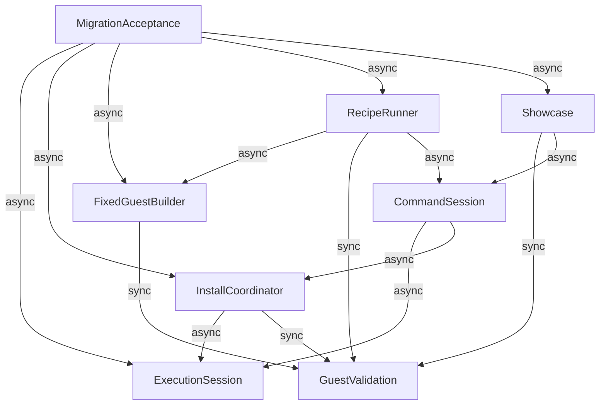

# 移管の論理コンポーネント

## 根拠

`../requirements-analysis/requirements.md`、`aidlc/spaces/default/codekb/formicarium/architecture.md`、`component-inventory.md`を参照する。8つの論理部品を定義し、配置/公開関数shape/型/制限値は後続で確定する。これは設計（ドキュメント根拠）で、実装成功の主張ではない。Q1=Aによりcommandとinstallを分離する。

## Component Catalogue

```yaml
{
  "components": [
    {
      "name": "ExecutionSession",
      "summary": "汎用実行とセッション状態を所有する",
      "behaviour": "runと導入の共通busy予約、epoch、取消、原子的guest登録、FS/cwd、reset/disposeを所有する。runごとのWorkerとcore検証境界を維持し、tool/verdict/buildを知らない。",
      "responsibilities": [
        "実行・FS・登録状態の唯一の所有者",
        "予約tokenとepochの確認、取消とcleanup"
      ],
      "depends_on": [],
      "entities": [
        {
          "name": "SessionState",
          "identifier": "sessionId",
          "attributes": [
            "epoch",
            "cwd",
            "files",
            "installedGuests",
            "activeOperation"
          ]
        }
      ],
      "dependents": [
        {
          "component": "InstallCoordinator",
          "interaction": "busy予約・epoch・登録commit・取消"
        },
        {
          "component": "CommandSession",
          "interaction": "builtinのFS/cwd操作とguest実行"
        },
        {
          "component": "MigrationAcceptance",
          "interaction": "工程試行と公開consumer受入"
        }
      ]
    },
    {
      "name": "GuestValidation",
      "summary": "guestとfixtureの検証・変換を集約する",
      "behaviour": "digest、ELF、build-infoの期待identity、fixtureのパス境界を検証し、検証したbyte copyを返す。取得・登録・verdictを行わない。",
      "responsibilities": [
        "重複した検証の公開境界への集約",
        "検証済み入力とFsEntry変換"
      ],
      "depends_on": [],
      "entities": [
        {
          "name": "ValidatedGuest",
          "identifier": "artifactDigest",
          "attributes": [
            "bytes",
            "buildInfo",
            "sourceIdentity",
            "fixtureEntries"
          ]
        }
      ],
      "dependents": [
        {
          "component": "InstallCoordinator",
          "interaction": "取得guestとmetadata/fixtureの検証"
        },
        {
          "component": "FixedGuestBuilder",
          "interaction": "ELF/build-info検証を公開API経由で利用"
        },
        {
          "component": "RecipeRunner",
          "interaction": "実行前に固定commit/digest/fixtureを照合する"
        },
        {
          "component": "Showcase",
          "interaction": "公開guest APIで配布候補を検証"
        }
      ]
    },
    {
      "name": "InstallCoordinator",
      "summary": "カタログから取得・検証し導入を調整する",
      "behaviour": "install予約をExecutionSessionから取得し、catalog選択、有限取得、展開、GuestValidation、進捗とabortを調整する。成功時だけtokenとepochで登録。失敗・古い応答は旧登録を維持。",
      "responsibilities": [
        "catalog解釈と導入操作の進捗",
        "取消可能な取得・展開・検証の調整"
      ],
      "depends_on": [
        {
          "component": "ExecutionSession",
          "interaction": "busy予約・epoch・登録commit・取消",
          "style": "async"
        },
        {
          "component": "GuestValidation",
          "interaction": "取得guestとmetadata/fixtureの検証",
          "style": "sync"
        }
      ],
      "external_dependencies": [
        {
          "name": "Catalog asset hosting",
          "kind": "object-store",
          "purpose": "受入済みURLの取得。Release直接又は同originミラーは実測後に確定"
        }
      ],
      "entities": [
        {
          "name": "InstallOperation",
          "identifier": "operationId",
          "attributes": [
            "sessionId",
            "token",
            "epoch",
            "selection",
            "progress",
            "abort"
          ],
          "references": [
            {
              "entity": "SessionState",
              "owned_by": "ExecutionSession",
              "relationship": "導入対象のセッションを参照する"
            }
          ]
        },
        {
          "name": "CatalogSelection",
          "identifier": "selectionId",
          "attributes": [
            "tool",
            "versionOrName",
            "url",
            "digest",
            "buildInfoIdentity"
          ]
        }
      ],
      "dependents": [
        {
          "component": "CommandSession",
          "interaction": "install選択と進捗・中止"
        },
        {
          "component": "MigrationAcceptance",
          "interaction": "導入工程の測定"
        }
      ]
    },
    {
      "name": "CommandSession",
      "summary": "共通コマンド操作を解釈・振分けする",
      "behaviour": "argvとbuiltinを解釈し、installをInstallCoordinatorへ、FS/cwd/runをExecutionSessionへ渡す。状態を複製せず各操作のbusy/取消を伝える。shell構文を拒否する。",
      "responsibilities": [
        "入力解釈とコマンド振分け",
        "結果を表示用transcriptへ整形"
      ],
      "depends_on": [
        {
          "component": "ExecutionSession",
          "interaction": "builtinのFS/cwd操作とguest実行",
          "style": "async"
        },
        {
          "component": "InstallCoordinator",
          "interaction": "install選択と進捗・中止",
          "style": "async"
        }
      ],
      "entities": [
        {
          "name": "CommandRequest",
          "identifier": "commandId",
          "attributes": [
            "sessionId",
            "input",
            "argv"
          ],
          "references": [
            {
              "entity": "SessionState",
              "owned_by": "ExecutionSession",
              "relationship": "操作するセッションを参照する"
            }
          ]
        }
      ],
      "dependents": [
        {
          "component": "RecipeRunner",
          "interaction": "共通端末操作の実行"
        },
        {
          "component": "Showcase",
          "interaction": "公開コマンドAPIで端末を動かす"
        }
      ]
    },
    {
      "name": "FixedGuestBuilder",
      "summary": "vivariumの固定入力成果物を生成・再利用する",
      "behaviour": "完全sourceと依存・builder hashからbuild keyを作り、同keyを直列化。検証済みELFとbuild-infoを一組として保存・再利用する。verdict期待値を持たない。",
      "responsibilities": [
        "固定build入力と成果物の所有",
        "共通catalogの生成"
      ],
      "depends_on": [
        {
          "component": "GuestValidation",
          "interaction": "ELF/build-info検証を公開API経由で利用",
          "style": "sync"
        }
      ],
      "external_dependencies": [
        {
          "name": "Source repositories and native toolchain",
          "kind": "other",
          "purpose": "固定commitと依存のmusl build"
        },
        {
          "name": "Vivarium GitHub Releases",
          "kind": "object-store",
          "purpose": "固定成果物の保存と取得"
        }
      ],
      "entities": [
        {
          "name": "FixedBuild",
          "identifier": "buildKey",
          "attributes": [
            "tool",
            "repository",
            "commit",
            "builderHash",
            "dependencies",
            "digest",
            "buildInfo",
            "catalogEntry"
          ]
        }
      ],
      "dependents": [
        {
          "component": "RecipeRunner",
          "interaction": "ビルド時にrecipeの固定guestを準備する"
        },
        {
          "component": "MigrationAcceptance",
          "interaction": "固定buildと再利用証拠取得"
        }
      ]
    },
    {
      "name": "RecipeRunner",
      "summary": "vivarium再現UIとverdictを所有する",
      "behaviour": "recipeの固定期待値を照合し、fixtureとcommandを共通APIへ渡してbefore/afterを比較する。ready/run/transcriptとdeprecated Contract互換を維持する。sourceの固定buildはFixedGuestBuilderをビルド時だけ利用。",
      "responsibilities": [
        "recipe・fixture・比較期待値の所有",
        "端末とContract変換・verdict"
      ],
      "depends_on": [
        {
          "component": "FixedGuestBuilder",
          "interaction": "ビルド時にrecipeの固定guestを準備する",
          "style": "async"
        },
        {
          "component": "GuestValidation",
          "interaction": "実行前に固定commit/digest/fixtureを照合する",
          "style": "sync"
        },
        {
          "component": "CommandSession",
          "interaction": "共通端末操作の実行",
          "style": "async"
        }
      ],
      "entities": [
        {
          "name": "Recipe",
          "identifier": "recipeId",
          "attributes": [
            "guests",
            "fixture",
            "commands",
            "expectedOutcome",
            "runtimeName"
          ],
          "references": [
            {
              "entity": "FixedBuild",
              "owned_by": "FixedGuestBuilder",
              "relationship": "固定guestの出所を参照する"
            }
          ]
        },
        {
          "name": "ReproductionResult",
          "identifier": "resultId",
          "attributes": [
            "recipeId",
            "transcript",
            "before",
            "after",
            "verdict"
          ],
          "references": [
            {
              "entity": "Recipe",
              "owned_by": "RecipeRunner",
              "relationship": "実行したrecipeを参照する"
            }
          ]
        }
      ],
      "dependents": [
        {
          "component": "MigrationAcceptance",
          "interaction": "旧verdictと移行後の比較証拠取得"
        }
      ]
    },
    {
      "name": "Showcase",
      "summary": "latest安定版デモとサイト候補を所有する",
      "behaviour": "3ツールのlatestを一度解決し、取得/必要なsource build/検証/catalog化。公開APIで受入済みデモ候補だけを配布し、失敗時前回サイトを維持。回帰fixtureと共有しない。",
      "responsibilities": [
        "latestのtool設定・builder・demo fixture・siteの所有",
        "専用CIの受入と配布候補"
      ],
      "depends_on": [
        {
          "component": "GuestValidation",
          "interaction": "公開guest APIで配布候補を検証",
          "style": "sync"
        },
        {
          "component": "CommandSession",
          "interaction": "公開コマンドAPIで端末を動かす",
          "style": "async"
        }
      ],
      "external_dependencies": [
        {
          "name": "Official release assets or sources",
          "kind": "other",
          "purpose": "latest安定版入力の取得"
        },
        {
          "name": "Pages hosting",
          "kind": "object-store",
          "purpose": "受入済みサイトの配布"
        }
      ],
      "entities": [
        {
          "name": "ShowcaseCandidate",
          "identifier": "candidateId",
          "attributes": [
            "resolvedTools",
            "digests",
            "catalog",
            "fixtures",
            "site",
            "acceptanceEvidence"
          ]
        }
      ],
      "dependents": [
        {
          "component": "MigrationAcceptance",
          "interaction": "デモ受入と前回サイト保持を確認"
        }
      ]
    },
    {
      "name": "MigrationAcceptance",
      "summary": "移管の試行・受入・公開準備・退役証拠を照合する",
      "behaviour": "工程測定、基点照合、consumer受入、参照検索と案内・退役準備をスクリプトとして実装する。未検証/承認不足/両経路未達を成功扱いせず、既存公開executorを承認済み入力で利用する。製品本体から参照しない。",
      "responsibilities": [
        "測定と移管証拠の記録・照合",
        "公開と退役の準備・条件検査"
      ],
      "depends_on": [
        {
          "component": "ExecutionSession",
          "interaction": "工程試行と公開consumer受入",
          "style": "async"
        },
        {
          "component": "InstallCoordinator",
          "interaction": "導入工程の測定",
          "style": "async"
        },
        {
          "component": "FixedGuestBuilder",
          "interaction": "固定buildと再利用証拠取得",
          "style": "async"
        },
        {
          "component": "RecipeRunner",
          "interaction": "旧verdictと移行後の比較証拠取得",
          "style": "async"
        },
        {
          "component": "Showcase",
          "interaction": "デモ受入と前回サイト保持を確認",
          "style": "async"
        }
      ],
      "external_dependencies": [
        {
          "name": "Existing release and infrastructure executors",
          "kind": "other",
          "purpose": "承認後のnpm/JSR/Pages/archive/infra操作。新規公開権限は追加しない"
        }
      ],
      "entities": [
        {
          "name": "MigrationEvidence",
          "identifier": "evidenceId",
          "attributes": [
            "sourceIdentity",
            "phaseTimings",
            "testResults",
            "inputReferences",
            "approvals",
            "retirementReadiness"
          ]
        }
      ],
      "dependents": []
    }
  ]
}
```

## Component Diagram



テキスト代替：CommandSession→InstallCoordinator/ExecutionSession、InstallCoordinator→ExecutionSession/GuestValidation。FixedGuestBuilder→GuestValidation。RecipeRunner→FixedGuestBuilder（ビルド時のみ）/GuestValidation/CommandSession。Showcase→GuestValidation/CommandSession。MigrationAcceptanceは受入時に実行・導入・固定build・recipe・showcaseを利用する。逆向きの製品依存はない。

## Component Summary

| Component | Purpose | Depends On | Dependents | Entities Owned |
|---|---|---|---|---|
| ExecutionSession | 汎用実行とセッション状態を所有する | なし | InstallCoordinator, CommandSession, MigrationAcceptance | SessionState |
| GuestValidation | guestとfixtureの検証・変換を集約する | なし | InstallCoordinator, FixedGuestBuilder, RecipeRunner, Showcase | ValidatedGuest |
| InstallCoordinator | カタログから取得・検証し導入を調整する | ExecutionSession, GuestValidation | CommandSession, MigrationAcceptance | InstallOperation, CatalogSelection |
| CommandSession | 共通コマンド操作を解釈・振分けする | ExecutionSession, InstallCoordinator | RecipeRunner, Showcase | CommandRequest |
| FixedGuestBuilder | vivariumの固定入力成果物を生成・再利用する | GuestValidation | RecipeRunner, MigrationAcceptance | FixedBuild |
| RecipeRunner | vivarium再現UIとverdictを所有する | FixedGuestBuilder, GuestValidation, CommandSession | MigrationAcceptance | Recipe, ReproductionResult |
| Showcase | latest安定版デモとサイト候補を所有する | GuestValidation, CommandSession | MigrationAcceptance | ShowcaseCandidate |
| MigrationAcceptance | 移管の試行・受入・公開準備・退役証拠を照合する | ExecutionSession, InstallCoordinator, FixedGuestBuilder, RecipeRunner, Showcase | なし | MigrationEvidence |

## Entity Ownership

| Entity | Owning Component | Identifier | Attributes | References |
|---|---|---|---|---|
| SessionState | ExecutionSession | sessionId | epoch, cwd, files, installedGuests, activeOperation | なし |
| ValidatedGuest | GuestValidation | artifactDigest | bytes, buildInfo, sourceIdentity, fixtureEntries | なし |
| InstallOperation | InstallCoordinator | operationId | sessionId, token, epoch, selection, progress, abort | SessionState (ExecutionSession) |
| CatalogSelection | InstallCoordinator | selectionId | tool, versionOrName, url, digest, buildInfoIdentity | なし |
| CommandRequest | CommandSession | commandId | sessionId, input, argv | SessionState (ExecutionSession) |
| FixedBuild | FixedGuestBuilder | buildKey | tool, repository, commit, builderHash, dependencies, digest, buildInfo, catalogEntry | なし |
| Recipe | RecipeRunner | recipeId | guests, fixture, commands, expectedOutcome, runtimeName | FixedBuild (FixedGuestBuilder) |
| ReproductionResult | RecipeRunner | resultId | recipeId, transcript, before, after, verdict | Recipe (RecipeRunner) |
| ShowcaseCandidate | Showcase | candidateId | resolvedTools, digests, catalog, fixtures, site, acceptanceEvidence | なし |
| MigrationEvidence | MigrationAcceptance | evidenceId | sourceIdentity, phaseTimings, testResults, inputReferences, approvals, retirementReadiness | なし |

## External Dependencies

| Component | Dependency | Kind | Purpose |
|---|---|---|---|
| InstallCoordinator | Catalog asset hosting | object-store | 受入済みURLの取得。Release直接又は同originミラーは実測後に確定 |
| FixedGuestBuilder | Source repositories and native toolchain | other | 固定commitと依存のmusl build |
| FixedGuestBuilder | Vivarium GitHub Releases | object-store | 固定成果物の保存と取得 |
| Showcase | Official release assets or sources | other | latest安定版入力の取得 |
| Showcase | Pages hosting | object-store | 受入済みサイトの配布 |
| MigrationAcceptance | Existing release and infrastructure executors | other | 承認後のnpm/JSR/Pages/archive/infra操作。新規公開権限は追加しない |

## Rationale

| 境界 | 理由/代替 |
|---|---|
| ExecutionSession/GuestValidation | 状態・Worker寿命と純粋検証は別責任。既存core境界維持、検証重複を集約。検証をresolverへ残す案は公開利用と重複解消に合わない |
| CommandSession/InstallCoordinator | Q1選択A。argv/builtinと非同期取得の寿命・試験を分離。選択Bの一体化は取消状態が単純になるが責任が肥大するため不採用 |
| FixedGuestBuilder/RecipeRunner/Showcase | 固定入力・verdict・latestデモで変化理由が異なる。全builderを本体へまとめる案はtool固有の逆依存を生むため不採用 |
| MigrationAcceptance | FR1/FR6/FR16に必要な計測・consumer検証・退役条件の実コード。新しい常駐サービスや承認機関は作らず既存executorを利用する |

## 状態と取消の所有

SessionStateとinstalledGuestsの唯一の所有者はExecutionSession。InstallCoordinatorが持つのは処理中の予約token/epochと検証候補で、登録の副本を持たない。CommandSessionもcwd/FSを複製しない。reset/disposeはExecutionSessionのepochを更新しactiveOperationのabortを通知する。commitはtoken/epochが一致する成功候補だけ。run/installの排他は同じ予約境界で実施するため、command経由を迂回した直接API呼出しでも成立する。進捗callbackは通知で、受信側へ状態所有を渡さない。

RecipeとShowcaseのfixtureは各所有者に留め、GuestValidationへ変換用copyを渡す。FixedBuild metadataをrecipeが期待値として参照しても書換えない。Build keyとcatalog entryのschemaは契約設計で定義する。

## 要件と品質の対応

FR1/FR6/FR16はMigrationAcceptance、FR2はGuestValidation、FR3はCommandSession、FR4はInstallCoordinator、FR5はExecutionSession、FR7–9はFixedGuestBuilder、FR10–12はRecipeRunner、FR13–15はShowcaseを主担当とする。FR9の小試行とFR1計測はMigrationAcceptanceが呼び出す。

NFR1はMigrationAcceptance、NFR2はExecutionSessionと全受入、NFR3はGuestValidation/ExecutionSession、NFR4はInstallCoordinator/FixedGuestBuilder、NFR5はFixedGuestBuilder/Showcase、NFR6はExecutionSession/RecipeRunner、NFR7はCommandSession/RecipeRunner/Showcase、NFR8はMigrationAcceptance/全配布所有者に対応する。

## 後続と境界条件

Release直接取得か同originミラーかはFR1実測後に確定。download/build deadline・展開上限・関数shapeは契約設計で確定してから実装する。既存公開Session・cleanup・core・検証済みbyte実行を再利用し、大規模移管はB0通過まで開始しない。部品間graphは非循環。依存が同期か非同期かは呼出しの完了方式を表し、別deploy単位を意味しない。

